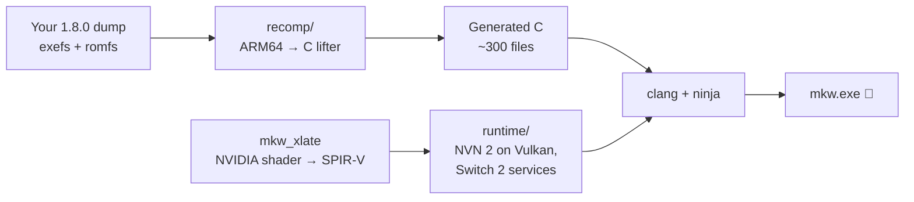

<div align="center">

# 🏁 MKW-THWOMP

### Mario Kart World, running natively on Windows PC

*A static recompilation of the Nintendo Switch 2 game, not an emulator.*

[](#-requirements)
[](#-under-the-hood)
[](#-quick-start)
[](#-status)
[](#-credits--licence)

**[Quick start](#-quick-start)** · **[Features](#-highlights)** · **[Status](#-status)** · **[How it works](#-under-the-hood)** · **[Contributing](#-for-contributors)**

</div>

---

> [!IMPORTANT]
> **No game files are included.** You need your own legally dumped copy of Mario Kart World with the **1.8.0 update**
> (exefs and romfs). This repository contains only the recompiler, the runtime and the build tools.

## ✨ Highlights

<table>
<tr>
<td width="50%" valign="top">

### 🚀 Native code, not emulation
Every ARM64 instruction of the game is translated **ahead of time** into C and compiled into a normal Windows
`.exe`. No CPU emulation runs while you play.

### 🎨 Full-resolution worlds
The open-world terrain megatextures (8192² × 68 layers) are streamed with **Vulkan sparse residency** at full
resolution, instead of being shrunk to fit. ASTC textures are recompressed to **BC7** on the GPU.

### 🌳 Correct foliage, finally
Trees, bushes and crowds are culled and sorted by the game's own **GPU compute passes**. They're now translated
faithfully, down to warp-level ballots, so no more phantom trees or blinking bushes.

</td>
<td width="50%" valign="top">

### 🎮 A real PC settings menu
Press **F1** or **Esc** (or **Minus + Plus** on a controller) for a Switch-2-style menu: Display, Sound,
Controls, System and Advanced, in a **light** or **dark (red)** theme.

### 🕹️ Controllers that just work
Xbox and generic SDL controllers, **DualSense** with rumble, and fully rebindable keyboard controls.

### 🔒 Offline and private
No network code and no telemetry. Settings live in a plain `mkw.ini` next to the game.

</td>
</tr>
</table>

## 📊 Status

| Area | State |
|---|---|
| Boot, intro movies, menus | ✅ Working |
| Races (e.g. Mario Circuit) | ✅ Playable |
| Terrain at full resolution (sparse residency, BC7) | ✅ Working |
| Trees, bushes and crowds (GPU culling) | ✅ Fixed (phantom trees and blinking foliage) |
| Audio | ✅ Working |
| Controllers, rumble, rebinding | ✅ Working |
| Online play | ❌ Not supported, by design |
| Every mode and course verified | 🚧 In progress |

**Known issues:**
- The first race after an update stutters while shaders are translated and cached.
- The GPU device is occasionally lost under heavy load. We're investigating.
- Not every mode and course has been tested yet. Reports are welcome.

## 🚀 Quick start

**1. Get the tools**

- Windows 10 or 11, and a GPU with Vulkan 1.3 (NVIDIA RTX recommended)
- [MSYS2](https://www.msys2.org/) UCRT64 with clang, ninja, the Vulkan headers, SDL3 and Opus
- Python 3.12, and the .NET 10 SDK (to build the shader translator)

**2. Build from your own dump**

```bat
set MKW_GAME=D:\path\to\your\mkw-1.8.0-dump
BUILD-MKW.bat
```

**3. Play**

```bat
RUN-MKW.bat
```

> [!TIP]
> To rebuild only the runtime after a code change, run `python tools\build_game.py --version mkw180 --out build\mkw`,
> then `ninja -f build\mkw\build.ninja` for incremental builds.

## 🖥️ Requirements

| | Minimum | Recommended |
|---|---|---|
| OS | Windows 10 64-bit | Windows 11 |
| CPU | x86-64 with AVX2 | 8 cores or more |
| GPU | Vulkan 1.3, 8 GB VRAM | NVIDIA RTX 40/50 series, 12 GB VRAM or more |
| RAM | 16 GB | 32 GB |
| Disk | ~40 GB free (dump plus build) | NVMe SSD |

## ⚙️ Settings

Press **F1** / **Esc** in game. Everything is saved to `mkw.ini` next to `mkw.exe`, and any setting can also be set
as an environment variable with the `MKW_` prefix (for example `MKW_FPS_LIMIT=60`).

| Tab | What you can change |
|---|---|
| **Display** | Window or fullscreen, V-Sync, frame-rate limit, performance overlay |
| **Sound** | Volume and output |
| **Controls** | Key and button bindings, rumble strength |
| **System** | Language, docked or handheld mode, menu theme, reset to defaults |
| **Advanced** | GPU selection, memory mode, logging |

The game renders at its own native resolution, exactly like the console. There are no upscalers and no frame
generation.

## 🔧 Under the hood



- **CPU:** the game's ARM64 code is lifted to C ahead of time. The runtime provides the Horizon kernel, services,
  file system, audio and input.
- **GPU:** the Switch 2's NVN 2 graphics API is reimplemented on **Vulkan 1.3**, including mesh shaders, sparse
  textures, indirect draws and the game's GPU-driven culling.
- **Shaders:** the game's NVIDIA shader binaries are translated to SPIR-V and cached, then rewritten where the
  hardware semantics differ (for example Maxwell's `0 × x = 0` and the per-draw base instance).

## 🛠️ For contributors

The repository includes tools that turn rendering bugs into data instead of guesswork:

| Tool | What it does |
|---|---|
| **F12** frame capture (`dump = key`) | Saves every render pass, target, pipeline and shader of one frame |
| `MKW_DUMP_PICK=1` | Shows which draw wrote each part of the screen |
| `MKW_DUMP_INST=<shader\|all>` | Snapshots each draw's GPU commands and per-instance records |
| `MKW_DUMP_CS` | Before/after snapshots of the GPU culling passes |
| **F9** recorder (`MKW_DRAWSTATS=key:300`) | Per-frame draw and instance counts, to catch flicker |
| `tools/cull_chain.py`, `tools/lod_recompute.py` | Offline analysis of the culling and LOD passes |

See [`HANDOVER.md`](HANDOVER.md) for the full project state, the root causes fixed so far and where to look next.

## 🙏 Credits & licence

Built on the shoulders of the open-source recompilation community, among others:

- **TotK Recomp** (MIT), the base of this runtime
- **LAS Recomp** (MIT), the lifter and code generator
- **MacNativeGames** and **d2r-mobile** (MIT), the host runtime and NVN front end
- **Eden / Eglantine** (GPL-3.0-or-later), shader recompilation
- **Ryujinx** (MIT), the shader translator
- **Dear ImGui**, **SDL3** and **Opus**

Thanks also to [adriadam10/mkw-recomp](https://github.com/adriadam10/mkw-recomp) (MIT), whose notes confirmed the
base-instance diagnosis.

This project is licensed under **GPL-3.0-or-later** (see [`LICENSE`](LICENSE)). Parts inherited from MIT-licensed
projects keep their notices (see [`LICENSE-MIT`](LICENSE-MIT) and
[`THIRD_PARTY_NOTICES.md`](THIRD_PARTY_NOTICES.md)).

---

<div align="center">

<sub>Mario Kart World is a trademark of Nintendo. This is an unofficial fan project, not affiliated with or endorsed
by Nintendo. Please support the official release.</sub>

</div>
