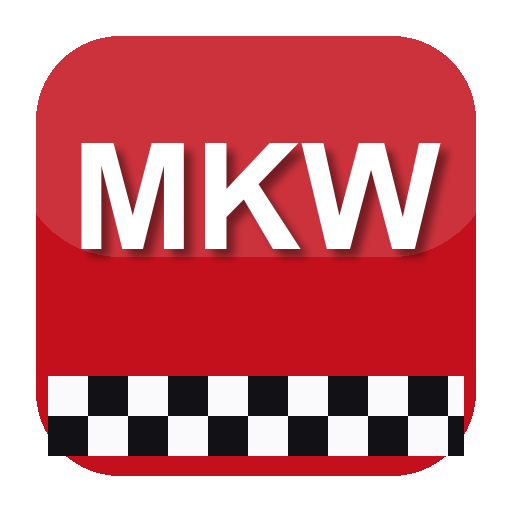
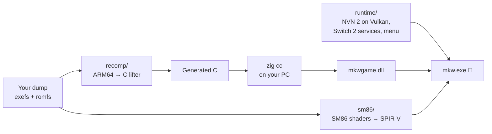

<div align="center">



# 🏁 MKW-THWOMP

### Mario Kart World, running natively on Windows PC

*A static recompilation of the Nintendo Switch 2 game, not an emulator.*

[](#-requirements)
[](#-under-the-hood)
[](#-quick-start)
[](#-quick-start)
[](#-status)
[](#-credits--licence)

**[Quick start](#-quick-start)** · **[Features](#-highlights)** · **[Status](#-status)** · **[How it works](#-under-the-hood)** · **[Credits](#-credits--licence)**

</div>

---

> [!IMPORTANT]
> **No game files are included.** You need your own legally dumped copy of Mario Kart World (**1.0.0** or the
> **1.8.0** update): `exefs` and `romfs`. This repository contains only the recompiler, the runtime and the tools.

> [!NOTE]
> MKW-THWOMP is built on **[adriadam10/mkw-recomp](https://github.com/adriadam10/mkw-recomp)** (MIT), the port that
> runs Mario Kart World at a locked 60 fps. THWOMP adds its own look and tools on top: the Switch-2-style settings menu,
> the performance overlay, the app icon and a native Windows build. Everything else is upstream's work.

## ✨ Highlights

<table>
<tr>
<td width="50%" valign="top">

### 🚀 Native code, not emulation
Every ARM64 instruction of the game is translated **ahead of time** into C and compiled on your PC into
`mkwgame.dll`. No CPU emulation runs while you play.

### 🎨 Shaders ready before you race
All 11 604 of the game's shader programs are translated to SPIR-V **during setup**, and the pipelines are warmed
once, so worlds don't pop in while you drive.

### 🏎️ 60 fps races
NVN 2 reimplemented on **Vulkan 1.3** with device-local memory mirrors, asynchronous replay and GPU-timed reports:
races hold 60 fps on current GPUs. FSR, NVIDIA DLSS and Frame Generation (2×–6×, Off by default) are there when you want more.

</td>
<td width="50%" valign="top">

### 🎮 A real PC settings menu
Press **F1** or **Esc** (or **Minus + Plus** on a controller, or the **touchpad** on a PS4 or PS5 controller) for a Switch-2-style menu with a category list:
Screen, Graphics, Game, Sound, Controls, Menu, Advanced and Hacks, in the **SteelTemple** theme (dark with chequered racing bands, the default), **dark (red)** or **light**.

### 📈 Performance overlay
FPS with the **1 % and 0.1 % lows** and the frame time in one pill in the corner, or a full panel with CPU, GPU
and memory.

### 🕹️ Controllers that just work
Xbox, DualSense and Switch 2 controllers (USB and Bluetooth), motion controls, rumble and fully rebindable
buttons and keys. Local multiplayer, LAN play, mods and 20 menu languages.

</td>
</tr>
</table>

## 📊 Status

| Area | State |
|---|---|
| Boot, intro movies, menus | ✅ Working |
| Races and free roam | ✅ Playable, 60 fps on high-end GPUs |
| Collision, props, lights | ✅ Working |
| Audio (stereo and 5.1) | ✅ Working |
| Controllers, rumble, rebinding, local multiplayer | ✅ Working |
| Online play | ❌ Not supported, by design |

## 🚀 Quick start

**1. Build the runtime** (Windows, from this repository)

```bat
uv run tools/build/windeps.py
uv run tools/build/build.py --dist --runtime-only --target windows
uv run tools/build/dist.py --target windows
```

This gives the player's folder in `build\dist\windows`: `mkw.exe`, its DLLs and the setup.

**2. Set the game up from your dump** (copy that folder where you want the game first)

```bat
setup\python\python.exe setup\src\tools\prepare\prepare.py --source D:\path\to\your\dump --game . --romfs link
```

The setup checks your dump, compiles the game code, translates the shaders and warms the pipelines once
(about 5 minutes on an 8-core CPU).

**3. Play**: run `mkw.exe`.

## 🖥️ Requirements

| | Minimum | Recommended |
|---|---|---|
| OS | Windows 10 64-bit | Windows 11 |
| CPU | x86-64 with AVX2 | 8 cores or more |
| GPU | Vulkan 1.3, 8 GB VRAM | NVIDIA RTX 40/50 series, 12 GB VRAM or more |
| RAM | 16 GB | 32 GB |
| Disk | ~30 GB free during setup | NVMe SSD |

## ⚙️ Settings

Press **F1** / **Esc** in game. Everything is saved to `mkw.ini` next to `mkw.exe`, and any setting can also be set
as an environment variable with the `MKW_` prefix (for example `MKW_MENU_THEME=dark`).

## 🔧 Under the hood



- **CPU:** the game's ARM64 code is lifted to C ahead of time ([recomp/](recomp/README.md)). The runtime provides
  the kernel, the SDK by function name, file system, audio and input ([runtime/](runtime/README.md)).
- **GPU:** the Switch 2's NVN 2 graphics API is reimplemented on **Vulkan 1.3**, including mesh shaders, sparse
  textures, indirect draws and the game's GPU-driven culling.
- **Shaders:** the game's SM86 binaries are translated to SPIR-V offline by [sm86/](sm86/README.md).

Developer documentation: [AGENTS.md](AGENTS.md), [CONTRIBUTING.md](CONTRIBUTING.md), [docs/](docs/README.md) and the
README in every folder.

| Folder | Contents |
|---|---|
| [recomp/](recomp/README.md) | The generator: AArch64 → C |
| [runtime/](runtime/README.md) | Kernel, memory, SDK replacements, NVN 2 over Vulkan, audio, input, menus and the start screen |
| [sm86/](sm86/README.md) | The shader translator: SM86 SASS → GLSL → SPIR-V |
| [i18n/](i18n/README.md) | The menu, start screen and setup texts in every language (gettext `.po`) |
| [tools/](tools/README.md) | Analysis, setup, build, the installer, game runs and diagnostics |
| [tests/](tests/README.md) | Tests without the game or a GPU |
| [docs/](docs/README.md) | Research, sources and performance |
| `.github/` | CI, release, issue and pull request templates |

At the root: `pyproject.toml` and `uv.lock` (the Python environment of the tools), `.gitignore`, `LICENSE`,
`CONTRIBUTING.md`, `CHANGELOG.md` (each release's notes, THWOMP's first) and `AGENTS.md`.

## 🙏 Credits & licence

MKW-THWOMP is a fork of **[mkw-recomp](https://github.com/adriadam10/mkw-recomp)** by Adrià (MIT): the recompiler,
the runtime, the shader translator, the setup and nearly everything that makes the game run are theirs. Their own
credits, in [docs/research.md](docs/research.md#sources), include totk-pc-recomp, SavageWindRecomp, smo-recomp,
nvsass-disassembler, DocumentSASS, Dear ImGui, SDL3 and Opus.

This project is licensed under the **MIT License** (see [`LICENSE`](LICENSE)). Code taken from other projects keeps
its own licence in the `LICENSE.*` files next to it.

---

<div align="center">

<sub>Mario Kart World is a trademark of Nintendo. This is an unofficial fan project, not affiliated with or endorsed
by Nintendo. Please support the official release.</sub>

</div>
